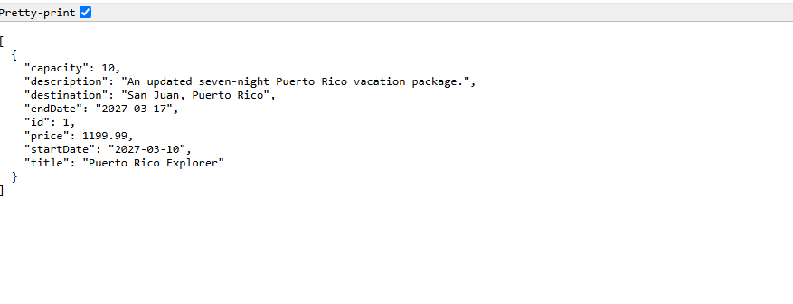
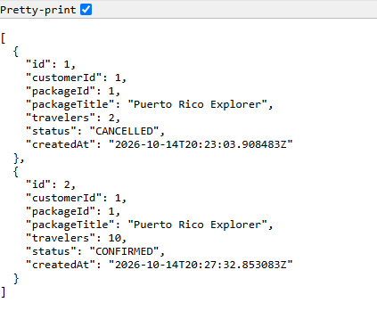
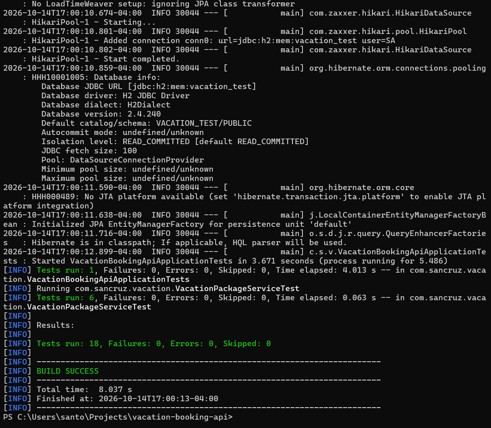

# Vacation Booking API

**Java 21 | Spring Boot | Spring Data JPA | MySQL | REST API**

Vacation Booking API is a backend application I developed using Java and Spring Boot. It provides REST endpoints for managing vacation packages, customers, excursions, and reservations.

The application uses MySQL for persistent data storage and includes validation, booking capacity management, reservation cancellation, and automated testing.

## API Screenshots

### Vacation Packages

`GET /api/packages`



### Reservations

`GET /api/reservations`



### Automated Tests



## Problem

Managing vacation packages and customer reservations requires keeping track of multiple types of information, including available packages, customer details, excursions, and booking capacity.

Without a centralized backend, maintaining these relationships and preventing invalid reservations can become difficult.

I wanted to develop a REST API that organizes this information and enforces business rules to maintain consistent booking data.

## Solution

I built a Spring Boot REST API that connects customers, vacation packages, excursions, and reservations through a relational MySQL database.

The application supports creating and managing vacation packages, registering customers, adding excursions to packages, and processing reservations.

I also implemented booking capacity validation to prevent overbooking, cancellation functionality that releases reserved capacity, and safeguards that prevent deleting records with associated booking history.

## Features

- **Vacation Package Management:** Create, retrieve, update, and delete vacation packages.
- **Customer Management:** Register customers, update information, and prevent duplicate email addresses.
- **Excursion Management:** Associate excursions with vacation packages and manage excursion details.
- **Reservation Management:** Create reservations and associate customers with vacation packages.
- **Capacity Validation:** Prevent reservations from exceeding available package capacity.
- **Reservation Cancellation:** Cancel reservations while preserving booking history.
- **Capacity Restoration:** Exclude cancelled reservations when calculating occupied capacity.
- **Date Validation:** Reject vacation packages with invalid date ranges.
- **Deletion Safeguards:** Prevent deleting customers or packages with associated reservation history.
- **Input Validation:** Validate request fields using Jakarta Bean Validation.
- **Persistent Storage:** Store application data in MySQL.
- **Automated Testing:** Verify business rules using JUnit and Mockito.

## Technologies Used

| Technology | Purpose |
|---|---|
| Java 21 | Backend application development |
| Spring Boot 4 | Application framework |
| Spring Web MVC | REST controllers and HTTP endpoints |
| Spring Data JPA | Database access |
| Hibernate | Object-relational mapping |
| MySQL 8.4 | Persistent relational database |
| Jakarta Bean Validation | Request validation |
| JUnit 5 | Automated testing |
| Mockito | Mocking dependencies during unit tests |
| H2 Database | Isolated in-memory test database |
| Maven | Dependency management and builds |
| Git & GitHub | Version control and documentation |

## Application Architecture

The application follows a layered backend architecture:

1. **REST Controllers:** Receive HTTP requests and return JSON responses.
2. **Request and Response DTOs:** Define API input and selected output structures.
3. **Service Layer:** Implements business logic, validation, and reservation rules.
4. **Repository Layer:** Performs database operations using Spring Data JPA.
5. **MySQL Database:** Persists customer, package, excursion, and reservation records.

This separation keeps HTTP request handling independent from business rules and database operations.

## Database Relationships

The application includes four primary entities:

| Entity | Responsibility |
|---|---|
| VacationPackage | Stores travel packages, dates, prices, and capacity |
| Customer | Stores customer contact information |
| Excursion | Stores activities associated with vacation packages |
| Reservation | Connects customers to packages and tracks booking status |

The relationships are organized as follows:

- One vacation package can have multiple excursions.
- One vacation package can have multiple reservations.
- One customer can have multiple reservations.
- Each reservation belongs to one customer and one vacation package.

Reservations use `CONFIRMED` and `CANCELLED` statuses.

## REST API Endpoints

### Vacation Packages

| Method | Endpoint | Description |
|---|---|---|
| GET | `/api/packages` | Retrieve all packages |
| GET | `/api/packages/{id}` | Retrieve a package |
| POST | `/api/packages` | Create a package |
| PUT | `/api/packages/{id}` | Update a package |
| DELETE | `/api/packages/{id}` | Delete a package |

### Customers

| Method | Endpoint | Description |
|---|---|---|
| GET | `/api/customers` | Retrieve all customers |
| GET | `/api/customers/{id}` | Retrieve a customer |
| POST | `/api/customers` | Create a customer |
| PUT | `/api/customers/{id}` | Update a customer |
| DELETE | `/api/customers/{id}` | Delete a customer |

### Excursions

| Method | Endpoint | Description |
|---|---|---|
| GET | `/api/packages/{packageId}/excursions` | List excursions |
| GET | `/api/packages/{packageId}/excursions/{id}` | Retrieve an excursion |
| POST | `/api/packages/{packageId}/excursions` | Create an excursion |
| PUT | `/api/packages/{packageId}/excursions/{id}` | Update an excursion |
| DELETE | `/api/packages/{packageId}/excursions/{id}` | Delete an excursion |

### Reservations

| Method | Endpoint | Description |
|---|---|---|
| GET | `/api/reservations` | Retrieve reservations |
| GET | `/api/reservations/{id}` | Retrieve a reservation |
| POST | `/api/reservations` | Create a reservation |
| POST | `/api/reservations/{id}/cancel` | Cancel a reservation |

## Example API Request

The following request creates a vacation package.

**POST `/api/packages`**

```json
{
  "title": "Puerto Rico Explorer",
  "destination": "San Juan, Puerto Rico",
  "description": "A seven-night vacation package exploring Puerto Rico.",
  "price": 1299.99,
  "capacity": 12,
  "startDate": "2027-03-10",
  "endDate": "2027-03-17"
}
```

A successful request returns HTTP `201 Created` with the saved package information and its generated ID.

## Booking Capacity Management

The reservation system calculates occupied capacity using confirmed reservations.

For example, if a vacation package has a capacity of 10 travelers and 8 travelers have confirmed reservations, only 2 additional travelers can book.

Requests exceeding the remaining capacity are rejected with HTTP `409 Conflict`.

When a reservation is cancelled, its travelers are excluded from the confirmed booking total, making those seats available again.

The application also uses database row locking during reservation creation to coordinate capacity checks.

## Validation and Error Handling

The API includes several business rules:

- Vacation end dates cannot occur before their start dates.
- Vacation prices and capacities must meet validation requirements.
- Customer email addresses must be valid and unique.
- Reservations must reference existing customers and vacation packages.
- Bookings cannot exceed available capacity.
- Package capacity cannot be reduced below confirmed bookings.
- Customers with reservation history cannot be deleted.
- Packages with reservations or excursions cannot be deleted.
- Already-cancelled reservations cannot be cancelled again.

The application uses HTTP status codes including:

| Status | Meaning |
|---|---|
| 200 | Successful retrieval or update |
| 201 | Resource created |
| 204 | Resource deleted successfully |
| 400 | Invalid request |
| 404 | Resource not found |
| 409 | Business-rule conflict |

## Getting Started

### Prerequisites

- Java 21 or newer
- MySQL 8.x
- MySQL database and application credentials
- Git

The project includes the Maven Wrapper, so a separate Maven installation is not required.

### 1. Clone the Repository

```bash
git clone https://github.com/sancruz68/vacation-booking-api.git
```

### 2. Open the Project Directory

```bash
cd vacation-booking-api
```

### 3. Configure MySQL

Create a local database named:

`vacation_booking`

Configure a dedicated MySQL application user with access to that database.

The application expects its database password from the `VACATION_DB_PASSWORD` environment variable.

Database credentials should not be committed to source control.

### 4. Start the Application

On Windows:

```powershell
.\mvnw.cmd spring-boot:run
```

On macOS or Linux:

```bash
./mvnw spring-boot:run
```

The application runs at:

`http://localhost:8081`

Example endpoint:

`http://localhost:8081/api/packages`

## Testing

I manually tested the REST endpoints and added automated tests using JUnit and Mockito.

### Automated Testing

The complete Maven test suite passed all 18 tests.

| Test Suite | Tests Passed |
|---|---:|
| ReservationServiceTest | 4 |
| VacationPackageServiceTest | 6 |
| CustomerServiceTest | 7 |
| Spring Boot Application Context | 1 |
| **Total** | **18** |

To run the tests on Windows:

```powershell
.\mvnw.cmd test
```

The Spring Boot application test uses an isolated H2 in-memory database rather than the development MySQL database.

### Manual API Testing

I also verified:

- Creating, retrieving, updating, and deleting vacation packages.
- Creating and retrieving customers.
- Rejecting duplicate customer emails.
- Creating and retrieving excursions.
- Creating and cancelling reservations.
- Rejecting bookings that exceed remaining capacity.
- Rejecting additional bookings when a package is full.
- Restoring booking capacity after cancellation.
- Preventing deletion of customers and packages with reservation history.
- Rejecting package capacity reductions below confirmed bookings.
- Rejecting invalid vacation date ranges.

## Current Limitations

- The application is intended for local development and demonstration.
- Authentication and role-based authorization have not been implemented.
- Database schema changes currently use Hibernate's development-oriented update behavior rather than versioned migrations.
- API documentation is maintained in the README rather than an interactive OpenAPI interface.
- Concurrent booking behavior has not been independently load-tested.
- The application has not been deployed to a production environment.

## Future Improvements

- Add authentication and authorization.
- Introduce database migrations using Flyway.
- Expand automated integration and concurrency testing.
- Add interactive OpenAPI documentation.
- Implement reservation searching and filtering.
- Add structured error responses.
- Deploy the API to AWS with a managed database.

## What I Learned

This project gave me additional experience developing REST APIs with Java and Spring Boot.

I worked with relational database entities, request validation, service-layer business logic, transactional database operations, and HTTP response handling.

I also gained experience implementing reservation capacity rules, protecting data relationships, and writing automated tests that verify backend behavior independently from the development database.
